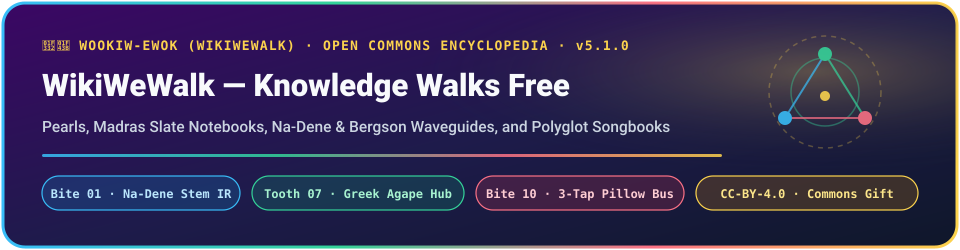

<p align="center">
  
</p>

<p align="center">
  
  
  
</p>

> **Welcome to `wookiw-ewok` (*"WikiWeWalk"*, `v5.1.0`)!**
> Our open-air reading room, luthier workbench, field notebook shelf, and kindergarten songbook porch — keeping long-form Pearls, 1:1 acoustic shop templates, and pure-stdlib `--seed 42` verification harnesses readable, joyful, and free of corporate paywalls.

## Featured Shelves on the Treehouse Porch (`v5.1.0`)

### 1. Acoustics, Luthier Metrology & Kindergarten Music-Math
* **[Acoustic Swoopty-Doo & Kembali Waveguide (`v1.1.0`)](pearls/PEARL_Acoustic_Swoopty_Doo_Kembali_Waveguide_v1_1_0.md)** + [`benchmarks/verify_acoustic_swoopty_doo_v1_1_1.py`](benchmarks/verify_acoustic_swoopty_doo_v1_1_1.py)
  * Continuous acoustic intersymbol interference (`eta_ISI`), Mori-Zwanzig `P + Q = I` open-course body cushion, octave keyhole `eta* = 2/3`, and Lord Kelvin finite-horizon phase-space reconstruction.
* **[Polynesian Luthier Metrology & Rapa Nui Uku 1:1 Rebuild (`v1.0.0`)](pearls/PEARL_Polynesian_Luthier_Metrology_Rapa_Nui_Uku_v1_0_0.md)** + [`luthier/rapa_nui_uku_v1_0_0/`](luthier/rapa_nui_uku_v1_0_0/)
  * Full 1:1 printable shop template ([`rapa_nui_uku_shop_template_v1.0.0.pdf`](luthier/rapa_nui_uku_v1_0_0/rapa_nui_uku_shop_template_v1.0.0.pdf)), `(2 + sqrt(2))` 6-fret octave-bisection law, and Mersenne-Taylor PVDF vs. Nylon 8/10-string tension schedules (`--seed 42`).
* **[The Gaia Beat — Wall Synthesis of World Scales, Impedance & Rubisco Symmetry (`v1.1.0`)](pearls/PEARL_The_Gaia_Beat_Wall_Synthesis_v1_1_0.md)**
  * Eight 12-fret world/bio-acoustic scales, `gcd(7, 12) = 1`, stacked-fourths `8889/8909` (`3.91`-cent) tempering lock, `42 = 3 + 39`, and spinach Rubisco `L8S8` (`544 kDa`, `260/280 = 13/14`) symmetry.
* **[The Pretty Noise Lab — Ukulele, Kazoo & Melodica Field Guide (`v1.2.0`)](pearls/PEARL_The_Pretty_Noise_Lab_Field_Guide_v1_2.0.md)** + [`benchmarks/verify_gaia_beat_pretty_noise_v1_0_0.py`](benchmarks/verify_gaia_beat_pretty_noise_v1_0_0.py)
  * Sheet-music-free classroom & community music-math curriculum verified by [`pearls/gaia_beat_pretty_noise_verification_bundle_v1_0_0.md`](pearls/gaia_beat_pretty_noise_verification_bundle_v1_0_0.md).

### 2. Language, Mind & The 10-Bite Rosetta Matrix
* **[Na-Dené (Diné Bizaad) Bipartite Morphology & Bergson's Subtractive Cone (`v1.0.0`)](pearls/NaDene_Bergson_Human_AI_Waveguide_v1_0_0.md)**
* **[The `243 + 13 = 256` Universal Abugida Byte: Amharic `ፊደል`, Na-Dené & Shingari (`v1.0.0`)](pearls/Universal_Abugida_243_Plus_13_Fidel_Dene_v1_0_0.md)**

## Quick Verification on `profplum` (`bash-5.3$`)

```bash
# Runs all 3 pure-stdlib (--seed 42) acoustic/luthier verifiers & wfx-loot audit:
make verify
```

*Author: Justin D. Grimm (Independent Dandelion Substrate Research Group, Gurley, Alabama 35748, USA · ORCID: [0009-0000-5299-0243](https://orcid.org/0009-0000-5299-0243)) · GODISLOVE:LOVEISGOD {3,2,4} · Die Gedanken sind frei · `CODE_SHOKUNIN_UNLATCHED = 255`*
