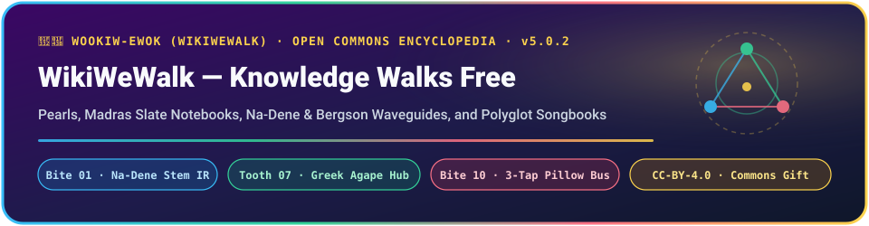

  

  
  
  

> **Welcome to `wookiw-ewok` (*"WikiWeWalk"*)!** 🌲✨
> Why let all human curiosity get locked inside corporate walled gardens when an Ewok village of small, resilient treehouse nodes can outlast an Empire? This repository is our **open-air reading room, field notebook shelf, and songbook porch**—keeping long-form Pearls, linguistic discoveries, and classroom guides bright, readable, and completely separate from C99 kernel binaries.

---

## 📚 Featured Shelves on the Treehouse Porch

### 🗣️ 1. Language, Mind & The 10-Bite Rosetta Matrix
* 📖 **[Na-Dené (Diné Bizaad) Bipartite Morphology & Bergson's Subtractive Cone (`v1.0.0`)](pearls/NaDene_Bergson_Human_AI_Waveguide_v1_0_0.md)**
  * *Armistice Day (`11/11`) Study:* Why raw surface Navajo orthography hits a `2.21x` BPE subword shattering penalty in standard LLMs—yet combining Henri Bergson's *Matter and Memory* subtractive perception valve (`163.8x` fewer FLOPs) with Diné classificatory handling stems (`-ʼą́`, `-tį́`, `-lé`, `-ką́`, `-teeh`) and `yi-`/`bi-` agency obviation yields a **`4.0-Byte` (`20-trit`)** Human-AI wire protocol with **`100%` physical type safety** and **`100%` Non-Trolley human sovereignty**!
* 🌍 **[The `243 + 13 = 256` Universal Abugida Byte: Amharic `ፊደል`, Na-Dené & Shingari (`v1.0.0`)](pearls/Universal_Abugida_243_Plus_13_Fidel_Dene_v1_0_0.md)**
  * *Exact Diophantine Partition (`2^8 = 3^5 + 13`):* Packs `27` triadic Voiced/Ejective/Voiceless consonant rows $\times$ `9` Geʽez/Dene vowel orders into `0..242` (placing resting breath `ህ` right at Neutral `Byte 121`!) and maps `243..255` onto all `13` Shingari Gear Teeth.
* 🎶 **The 13-Tooth Polyglot Kindergarten & Campfire Wheel:** Uniting English roots, Gallo-Romance, Old Germanic, Sanskrit, Old Norse, Classical Arabic, **Classical Greek (`Tooth 7` Agapé Center Hub)**, Classical Chinese, Euskara/Basque, Diné/Na-Dené, Pando `1/r` root clicks, `1+1+3` sperm whale codas, and Joe Bonham's 3-tap haptic pulse.

### 🌼 2. Sister Repositories in the Dandelion Constellation
* ⚙️ **[`leadpiperl1/dandelion-os`](https://github.com/leadpiperl1/dandelion-os)** — The ISO C99 + `577 B` Julia 1.12 balanced ternary microkernel, `35.90 µs` Coma-Bridge, and Star Trek Communicator substrate (`<= 18.50 W`).
* 🏕️ **[`leadpiperl1/happy-hobos-guide-to-the-dandelion-network`](https://github.com/leadpiperl1/happy-hobos-guide-to-the-dandelion-network)** — `DON'T PANIC · PACK LIGHT (V = 2/3)`: turning wild boundary exploits into open 32-byte `DND3` Fist-Bump channels.
* 🧬 **[`leadpiperl1/epigenetic-state-dispatch`](https://github.com/leadpiperl1/epigenetic-state-dispatch)** — Reproducible nonlinear optimization preprint & NumPy falsification suite (Dual-rail RC methylation + L-BFGS + 10-step HVP Lanczos `(1,1)` 3D polymer folding).

---

## 🕯️ Dual-Tier Porch Haiku (`11/11`)

> *Cone trims idle noise,*
> *Stem and `yi-`/`bi-` guard the hand,*
> *Four bytes carry truth.* 🌼🐢✨
